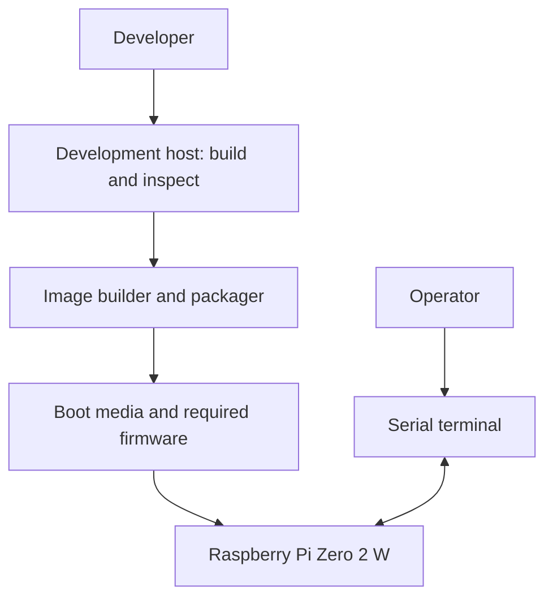
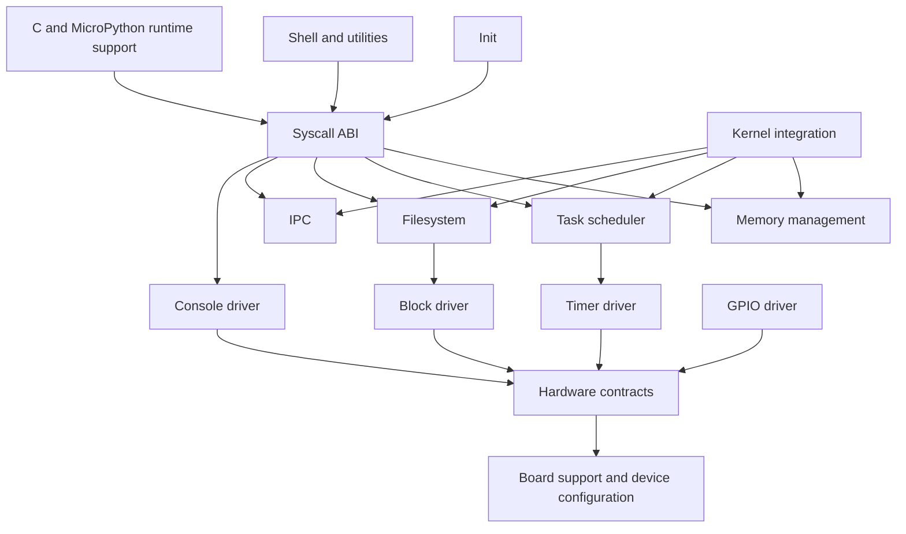
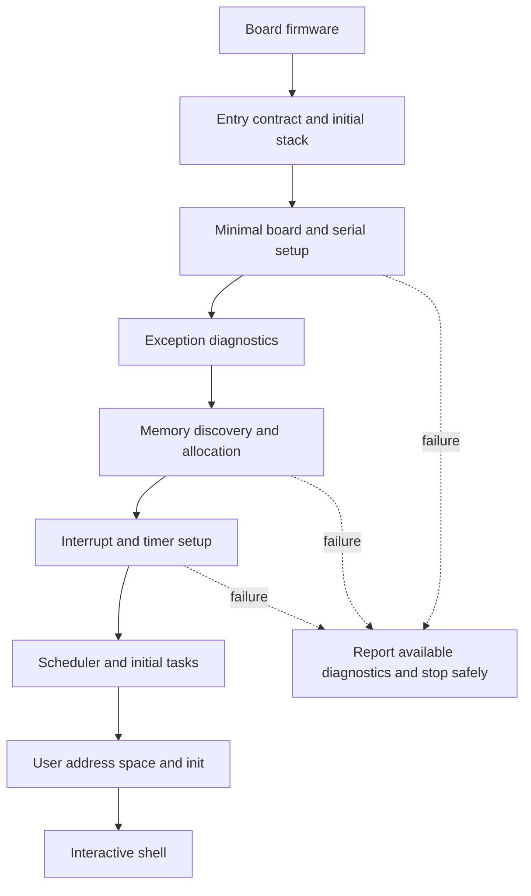
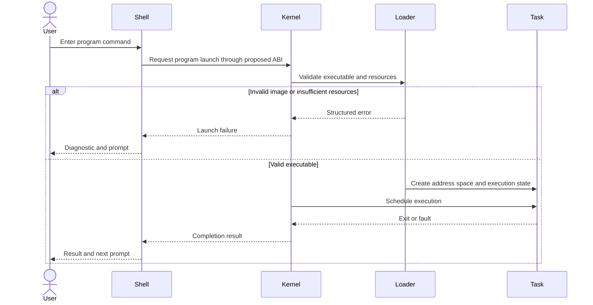

# Proposed RustOS architecture

This page describes the target operating system. The [assembler architecture](assembler-architecture.md) describes the host application that selects, builds, packages, and verifies those components; its component responsibility boundaries are agreed.

## Context and boundaries

The development host builds and packages artifacts. Board firmware loads the kernel under a contract still to be selected. RustOS owns its kernel and userland; it does not assume Linux services. The first hardware target is Raspberry Pi Zero 2 W, with AArch64 as the intended execution mode.

## Subsystems

Arrows below indicate proposed service use, not existing crate dependencies. Filesystem access to block storage applies to a future persistent backend; an early in-memory filesystem need not use it.

## Proposed boot flow

Only the early portion is needed for first boot. Later initialization ordering must be refined after the boot, memory, and interrupt designs are selected.

## Program execution workflow

## Safety and ownership

Board support owns board addresses and initialization assumptions. Drivers own device access; shared access needs an explicit synchronization policy. Memory management owns page and mapping lifetimes. Syscall dispatch validates user-provided values and pointers. Task teardown must release owned resources. Unsafe operations require documented invariants and fault-oriented verification.

These are design constraints, not guarantees provided by current code. Exception level, executable format, syscall ABI, address layout, locking, filesystem format, and image layout remain open. See the [feature catalog](features/README.md) for the corresponding specification proposals.
