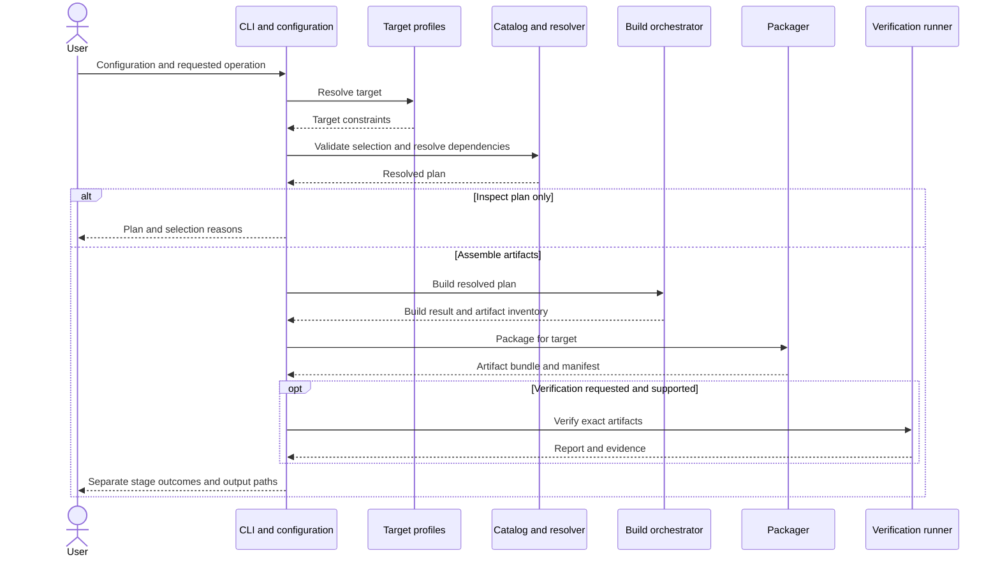

# OS assembler component ownership

## Decision

Agreed in the project discussion on 2026-10-31: one assembler application with six internal modules. RustOS kernel, drivers, and user programs are build inputs. This decision approves responsibility boundaries; concrete schemas, function signatures, and implementation remain pending.

| Module | Owns | Input | Output |
| --- | --- | --- | --- |
| CLI and configuration | Parsing selections, schema validation, command coordination, presentation of outcomes | Arguments and versioned configuration file | Structurally validated configuration or field-specific diagnostics |
| Target profiles | Architecture, board capabilities, boot requirements, supported formats and verification constraints | Target identifier and profile catalog | Target constraints or unknown/unsupported target error |
| Catalog and resolver | Module inventory, dependencies, compatibility, ordering, selection reasons | Configuration, target constraints, module metadata | Resolved build plan or dependency/compatibility diagnostics |
| Build orchestrator | Toolchain checks, compilation, build logs, identity of compiled inputs | Resolved plan and recorded toolchain inputs | Compiled artifact inventory and build result |
| Packager | Boot assets, image layout, packaging, component inventory and artifact manifest | Compiled artifacts, target packaging rules, boot assets | Target artifact bundle and manifest with hashes, or packaging failure |
| Verification runner | Emulator execution, expected-output checks, timeouts, result records | Packaged artifacts, target verification recipe | Verification report and evidence; physical hardware results are recorded separately |

## Coordination and contracts

The CLI coordinates calls; modules communicate through explicit data contracts rather than invoking each other's CLI commands. Configuration validation checks structure; the resolver checks semantic compatibility. A structurally valid configuration does not guarantee a supported build.

The resolved plan records the requested features, selected modules and dependency reasons, target constraints, build order, packaging mode, and applicable verification recipe. Downstream stages consume the same resolved plan. Record input identity so a later file change cannot silently substitute a different build input. The snapshot or change-detection mechanism is a pending design decision.

The build orchestrator owns compilation, not board register details. The packager owns output layout, not kernel behavior. The verification runner reports observed results; it cannot establish hardware compatibility from an emulator run. Kernel and driver modules remain responsible for their own resource ownership, synchronization, and error behavior.

Reports identify the failed stage, relevant configuration or artifact, reason, and recorded diagnostics. Exact error codes, serialization formats, interfaces, and timeout values remain open. Build, packaging, emulator verification, and hardware verification retain separate outcomes.

## Proposed integration sequence

This diagram describes the normal path. Failure, cancellation, staging, publication, and cleanup behavior are the next discussion; no failure policy is approved by this diagram.

## Research boundary

Hardware documentation, available source, hardware observations, and targeted REA investigations inform target profiles and driver specifications. For each finding, record source or artifact identity, documented facts, observations, inferences, unresolved behavior, and validation evidence. Reverse-engineering output is research evidence, not automatically a verified requirement or implementation. Device firmware replacement is separate from writing a Rust driver that communicates with firmware.

## Relationship to the existing scaffold

The existing image-builder and packager workspace entries are placeholders. Do not interpret them as separate approved applications. The one-application decision governs the host assembler; concrete crate boundaries and workspace restructuring require a later implementation design. The existing OS subsystem architecture describes target-side code and complements these host-side boundaries.

## Outstanding interface work

- Configuration and target/module metadata schemas.
- Concrete resolved-plan, artifact, manifest, error, and verification-report types.
- Ownership of run directories and output publication across stages.
- Emulator selection and exact verification recipes.
- Requirement-to-design-to-test traceability and active-work priorities.

See the [assembler requirements](assembler-requirements.md), [product direction](product-direction.md), and [documentation plan](plan.md). No implementation or verification completion is implied by this decision.
