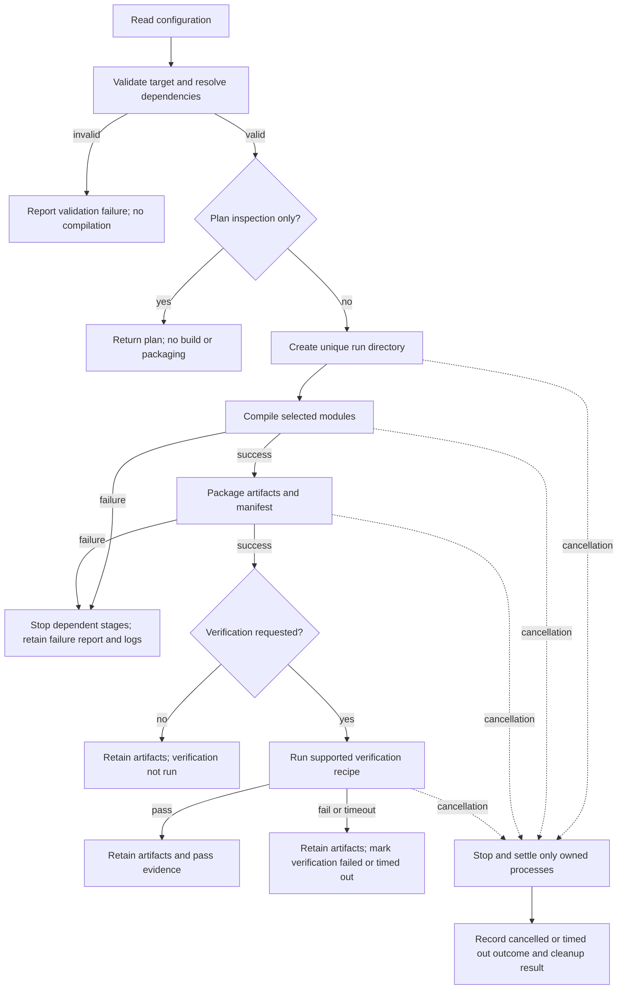

# Assembler workflow and failure policy

## Agreed policy

Agreed on 2026-10-31: validate before compiling; use a separate directory per run; stop dependent stages on failure; retain diagnostics; preserve existing successful outputs; retain artifacts with explicit failed or not-run verification status; stop owned processes on cancellation/timeout; keep physical media writing separate.

This is an approved policy, not an implemented execution engine. The [confirmed verification/publication policy](verification-publication-review.md) establishes separate test artifacts, marker deadlines, bounded cleanup and same-volume no-replacement publication. Concrete schemas, process ownership mechanisms and the production publisher still require implementation and tests.

## Normal and failure paths

## Stage ownership and failure effects

| Stage | Owner | Failure effect | Retained evidence |
| --- | --- | --- | --- |
| Parse and resolve | CLI/configuration, target profiles, resolver | No build starts; explain field, dependency chain, or conflict | Configuration identity and diagnostics, when writable |
| Prepare run | Coordinator in CLI | No dependent stage starts; existing outputs remain intact | Directory/path failure if it can be recorded |
| Compile | Build orchestrator | Packaging and verification do not start | Tool versions, command, exit status, stdout/stderr references |
| Package | Packager | No valid complete bundle or packaging-success marker is published | Partial-output location, failed step, build logs |
| Verify | Verification runner | Build/package outcomes remain intact; run exits nonzero on requested-test failure | Artifact hashes, target, recipe, markers, timeout and observed result |
| Cancel or timeout | Coordinator and active module | Stop only children owned by this run; record skipped downstream steps | Reason, process cleanup outcome, any retained partial output |
| Finalize report | Coordinator | Reporting failure must not be presented as overall success | Best-effort diagnostic; explicit unresolved publication state |

## Result semantics

- Planning states describe engineering work: not started, in progress, blocked, complete.
- Runtime step states are separate: not run, running, passed, failed, cancelled, timed out, skipped.
- A run retains individual step results. A failed requested test yields a failed overall run even when its build and package passed.
- A successful build-only command reports verification not run; it does not imply a verified release or completed M1.
- Emulator and physical-board verification use separate records with environment and artifact identity.
- The deliberate panic scenario passes only when its expected diagnostic and termination/timeout policy match the test recipe. An unexpected panic does not pass startup verification.

## Output preservation and cleanup

Use a unique run directory and reject an already occupied final destination by default. Stage outputs before publishing a complete bundle; establish the concrete publication protocol before implementation. Never overwrite a previous successful output implicitly. Retain failed-test artifacts as unverified, with the exact failure reason available in their report.

Cancellation and timeout must stop and settle owned child processes before marking cleanup complete. If cleanup fails, record it as unresolved; do not claim a clean end or start conflicting work. Diagnostic writes are best effort when storage is unavailable. Cleanup must not target unrelated processes or source files. Deleting retained runs requires a separate explicit retention policy; none is implemented yet.

## Proposed acceptance additions

| ID | Scenario | Expected result |
| --- | --- | --- |
| ASM-012 | Force compilation or packaging failure | Downstream steps skipped, nonzero outcome, logs retained, previous successful output unchanged |
| ASM-013 | Fail requested emulator verification after packaging | Artifact retained with failed verification; overall run fails; build/package results retained |
| ASM-014 | Cancel an active run or trigger its deadline | Owned processes settled; cancelled/timed-out outcome recorded; cleanup failure explicitly reported if settlement fails |
| ASM-015 | Inspect a run result in the progress dashboard | Show target, artifact identity, per-step outcome, verification scope, logs/evidence, and cleanup result; never infer success from missing data |

These acceptance scenarios need executable fixtures and exact interfaces before implementation. ASM-001 through ASM-011 remain defined in the [assembler requirements](assembler-requirements.md).
