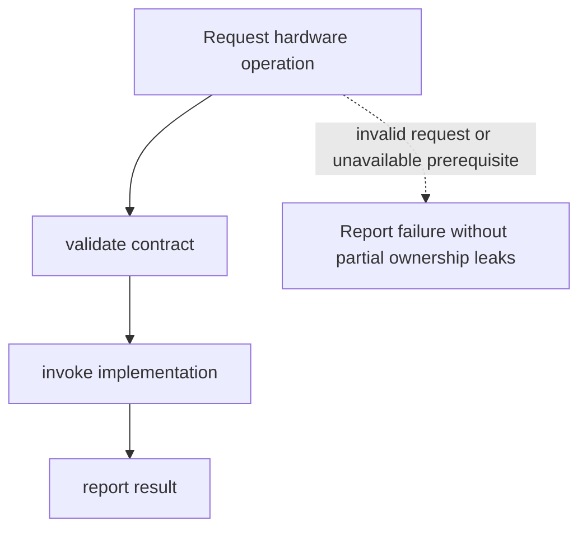

# Hardware abstraction

**Status:** initial proposal; requirements, analysis, design, and documentation drafted, not active or approved. Review, implementation, and verification have not started.

## Goal and scope

Separate portable services from device-specific operations. Deliver only the behavior required by the current milestone before extending coverage. See the [system architecture](../architecture.md) and [delivery plan](../plan.md).

## Initial requirements

- **HAL-001:** Separate portable services from device-specific operations through an explicitly documented interface.
- **HAL-002:** Define invalid inputs, unavailable resources, and failure results before implementation.
- **HAL-003:** Supply a repeatable procedure demonstrating: service code uses documented contracts with ownership and error rules.

These requirements need refinement and review; they are not an approved baseline. Specify concrete limits and observable outputs during analysis.

## Analysis and dependencies

Prerequisites: Kernel service needs and board constraints.

Compare the smallest implementation that satisfies the milestone with more capable alternatives. Record constraints, the selected approach, and deferred behavior. Dependency interfaces must be agreed before integration; a dependency listed here is not implemented.

## Proposed design

Proposed responsibilities follow this order: request hardware operation; validate contract; invoke implementation; report result. Before design completion, define interface signatures, input and output types, resource ownership, lifetime, concurrency assumptions, and errors. Keep board assumptions at the hardware boundary.

## Workflow

The failure edge is illustrative. Expand it into operation-specific failure and cleanup paths before design approval. Add sequence or lifecycle diagrams when the final interface makes cross-component interactions or state transitions concrete.

## Failure analysis

Identify invalid requests, missing prerequisites, resource exhaustion, and interrupted operations. Define which resources have been acquired at each step, how they are released, and whether the caller retries, receives an error, or triggers a kernel diagnostic. Kernel-fatal faults need an explicit panic policy rather than an assumption of recovery.

## Acceptance and verification

- Service code uses documented contracts with ownership and error rules.
- Exercise invalid input and unavailable-resource behavior defined by HAL-002.
- Record toolchain, target or board, exact procedure, expected output, actual result, and evidence reference.

No verification has run. Distinguish host tests, cross-compilation checks, and hardware evidence; one does not substitute automatically for another.

## Open decisions

Trait boundaries, static or dynamic dispatch, interrupt-safe access. Decide and document alternatives and rationale before claiming design completion.

## Review record

Pending. Record reviewer, date, specification revision, findings, dispositions, and outcome here. No approval is implied by this proposal.

## Next action

Refine HAL-001 through HAL-003 into reviewable behavior and limits; resolve the milestone-critical open decisions.
