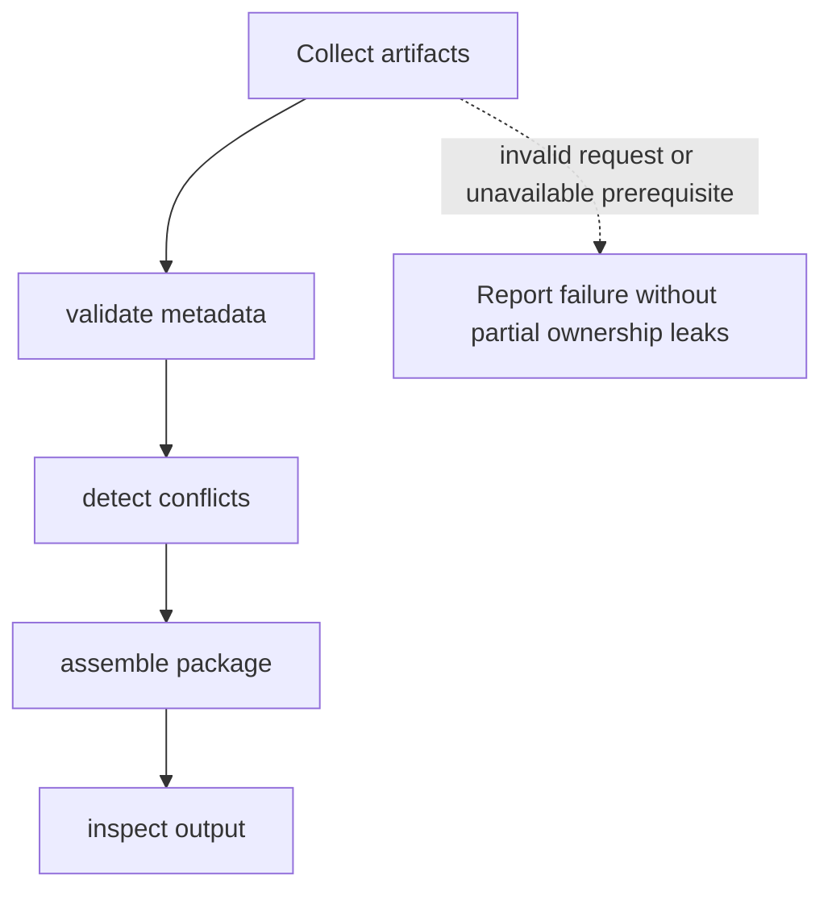

# Program and asset packaging

**Status:** initial proposal; requirements, analysis, design, and documentation drafted, not active or approved. Review, implementation, and verification have not started.

## Goal and scope

Package programs with compatible metadata and runtime assets. Deliver only the behavior required by the current milestone before extending coverage. See the [system architecture](../architecture.md) and [delivery plan](../plan.md).

## Initial requirements

- **PACKAGER-001:** Package programs with compatible metadata and runtime assets through an explicitly documented interface.
- **PACKAGER-002:** Define invalid inputs, unavailable resources, and failure results before implementation.
- **PACKAGER-003:** Supply a repeatable procedure demonstrating: package contents and compatibility can be inspected; invalid inputs are rejected.

These requirements need refinement and review; they are not an approved baseline. Specify concrete limits and observable outputs during analysis.

## Analysis and dependencies

Prerequisites: Executable format, filesystem, runtime requirements.

Compare the smallest implementation that satisfies the milestone with more capable alternatives. Record constraints, the selected approach, and deferred behavior. Dependency interfaces must be agreed before integration; a dependency listed here is not implemented.

## Proposed design

Proposed responsibilities follow this order: collect artifacts; validate metadata; detect conflicts; assemble package; inspect output. Before design completion, define interface signatures, input and output types, resource ownership, lifetime, concurrency assumptions, and errors. Keep board assumptions at the hardware boundary.

## Workflow

The failure edge is illustrative. Expand it into operation-specific failure and cleanup paths before design approval. Add sequence or lifecycle diagrams when the final interface makes cross-component interactions or state transitions concrete.

## Failure analysis

Identify invalid requests, missing prerequisites, resource exhaustion, and interrupted operations. Define which resources have been acquired at each step, how they are released, and whether the caller retries, receives an error, or triggers a kernel diagnostic. Kernel-fatal faults need an explicit panic policy rather than an assumption of recovery.

## Acceptance and verification

- Package contents and compatibility can be inspected; invalid inputs are rejected.
- Exercise invalid input and unavailable-resource behavior defined by PACKAGER-002.
- Record toolchain, target or board, exact procedure, expected output, actual result, and evidence reference.

No verification has run. Distinguish host tests, cross-compilation checks, and hardware evidence; one does not substitute automatically for another.

## Open decisions

Manifest format, ABI identification, versioning, integrity requirements. Decide and document alternatives and rationale before claiming design completion.

## Review record

Pending. Record reviewer, date, specification revision, findings, dispositions, and outcome here. No approval is implied by this proposal.

## Next action

Refine PACKAGER-001 through PACKAGER-003 into reviewable behavior and limits; resolve the milestone-critical open decisions.
