# M2: Zero 2 W hardware image plan

Status: research and design in progress, 2026-11-01. No Pi image or hardware boot has been verified. [M1 acceptance](m1-acceptance.md) remains complete within its emulator scope.

## Outcome and acceptance

The assembler must select a Zero 2 W profile, build our Rust kernel, and produce a bootable SD-card image with a manifest identifying every kernel and firmware input. Hardware acceptance requires captured normal-startup and deliberate-panic output from an identified Zero 2 W, bound to the exact tested artifacts. Image inspection and emulator tests are separate evidence; neither establishes physical-board success.

Media writing is a separate user-operated procedure. The assembler build command must never select or overwrite a physical disk.

## Ordered work

Current design checkpoint: [contract handoff](m2-contract-handoff.md). All 58 M2 synthetic contract tests pass; real source/asset packaging and runtime implementation remain pending.

| Item | Work | Exit evidence |
| --- | --- | --- |
| P6 | Resolve boot contract, asset provenance, serial setup and image design | Two recorded review passes, concrete proposal, user confirmation, hardware inventory |
| P7 | Extend profiles and board selection; implement board startup and console | Strict configuration tests, board-specific entry/linker/driver inspection, M1 regression results |
| P8 | Package and inspect SD images | Pinned firmware inputs and licences, image structure and extracted-file hash checks, negative tests |
| P9 | Prepare media procedure and capture hardware results | Exact image hash, board identification, serial capture, startup and panic results, recorded failures and retests |

P7 is active as the primary implementation item, starting with portable console preparation. P6 remains open in the supporting research/handoff slot because hardware inventory is unanswered. P8 and P9 remain queued. See [queue reconciliation and checked scope](p7-console-preparation.md).

```mermaid
flowchart LR
  Profile[Zero 2 W profile] --> Resolve[Validate selected modules and pinned assets]
  Resolve --> Build[Compile Rust board and kernel components]
  Build --> Package[Create SD image and manifest]
  Package --> Inspect[Inspect image structure and hashes]
  Inspect --> Media[Separate media preparation]
  Media --> Board[Boot identified physical board]
  Board --> Evidence[Capture serial startup and panic evidence]
  Evidence --> Dashboard[Record hardware result in dashboard]
```

## Findings and review state

First source review: official configuration documentation identifies FAT boot files and configurable kernel selection; Zero 2 W needs an explicit 64-bit boot choice for this AArch64 project. The official firmware repository publishes boot assets and their licence. These establish a documented integration route; they do not establish that our kernel boots.

The [second review findings](m2-second-review.md) now record source-level boot/serial checks, current implementation gaps and a twice-hashed firmware candidate. Register-level startup/serial design, image geometry and concrete schema contracts still need resolution. No detailed boot settings or image geometry are approved by this document.

| Gap | Required resolution before implementation |
| --- | --- |
| CPU entry | Establish firmware load address, exception level, register handoff and secondary-core behaviour. M1's entry assumptions cannot be carried over without verification. |
| Serial | Select UART, pin routing, clock and baud setup for bare-metal code. Linux device names or overlays alone do not prove our driver setup. |
| Boot assets | Pin a firmware commit; identify required firmware, device-tree/overlay inputs and paired assets; retain applicable licences and hashes. No mutable download during a reproducible build. |
| Image format | Specify partition scheme, FAT layout, image capacity, kernel format and deterministic packaging; verify against firmware requirements. |
| Variants | Specify how startup and deliberate-panic artifacts are packaged and individually identified during physical tests. |
| Modular selection | Extend the current QEMU-specific profile/build contracts without weakening validation or breaking M1. |
| Hardware setup | Record card/reader, power, 3.3 V serial adapter, GPIO header availability, board identity and Windows serial port. User inventory requested; not yet received. |
| Evidence | Define bounded capture and manual power-cycle procedure; record hardware result independently from host image inspection and QEMU regressions. |

## Primary sources

Checked 2026-11-01. URLs below are research references, not pinned build inputs.

- [Official boot configuration](https://www.raspberrypi.com/documentation/computers/config_txt.html)
- [Official configuration and boot-file documentation](https://www.raspberrypi.com/documentation/computers/configuration.html)
- [Official Zero hardware documentation](https://www.raspberrypi.com/documentation/computers/zero.html)
- [Official firmware repository](https://github.com/raspberrypi/firmware)
- [Firmware licence](https://github.com/raspberrypi/firmware/blob/master/boot/LICENCE.broadcom)
- [Official Zero 2 W device-tree source](https://github.com/raspberrypi/linux/blob/rpi-6.18.y/arch/arm/boot/dts/broadcom/bcm2710-rpi-zero-2-w.dts)

REA is available for specific unresolved binary questions. Downloading and decompiling an entire Raspberry Pi OS image is not needed for this initial documented boot investigation.

## Confirmed console direction

Decision D15 is agreed: PL011 transmit-only diagnostics at 115200 baud with Pi BSP-owned GPIO and firmware clock preparation. See the [console contract](m2-console-contract.md). Implementation and hardware verification remain pending; boot memory, image geometry and profile contracts remain open.

## Confirmed boot direction

Decision D16 is agreed: explicit 2 MiB load placement, separate Pi EL2-to-EL1 entry, one active core and bounded device-tree/reserved-memory validation. See the [boot contract](m2-boot-contract.md). Register-level implementation checks and hardware acceptance remain required. SD image geometry and profile/report contracts remain open.

## Confirmed image direction

Decision D17 is agreed: separate normal/panic 64 MiB MBR/FAT32 images, deterministic packaging and independent content inspection. See the [image contract](m2-image-contract.md). Asset licensing, target/profile and report contracts, media preparation and physical acceptance remain required.

## Confirmed modular contracts direction

Decision D18 is agreed: strict versioned Pi target/manifest/report contracts, exactly one board, offline locked assets and separate image inspection versus explicit hardware capture. See the [profile/report contract](m2-profile-report-contract.md). Concrete schemas and fixtures, asset licensing inventory and hardware setup remain P6 exit work.

## Confirmed real asset baseline

Decision D19 is agreed: the exact twice-checked real firmware/DTB lock, reproduced source archive and source/notice sidecar requirements are approved as the M2 implementation baseline. See the [asset-lock review](m2-asset-lock-review.md). The approved lock bytes remain unchanged; Pi runtime implementation and physical acceptance remain pending.
