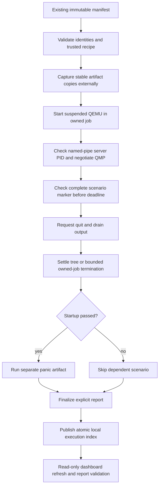

# P5 verifier and automatic execution visibility

Status: `-icount shift=auto` approved by the user on 2026-11-01 and included in M1 profile version 0.1.1. New runs use the approved profile; older provisional reports retain their historical labels. [M1/P5 acceptance is now complete](m1-acceptance.md), including the subsequent interruption and reporting/cleanup failure checks. This record extends [snapshot assembly](p5-build-verification.md).

## Implemented path

```powershell
rustos verify --repo . --manifest <bundle-directory>/manifest.json --format json
```

The CLI requires a manifest, rejects configuration options for verification, and never rebuilds. Typed schema-1 manifest parsing rejects unknown fields, duplicate or missing variants, unsupported targets, invalid timestamps/IDs/hashes, inconsistent captured selections, untrusted recipe identity, source tampering and artifact size/hash/ELF errors before guest launch. It checks every captured source file against the manifest and holds stable read handles. Hashes identify bytes; they do not authenticate an author.

Verification creates an exclusive external `.rustos-reports/<bundle-id>/<run-id>/` beside the bundle. It retains the exact consumed manifest, artifact copies, tool-version logs, launch arguments/PIDs, QMP transcripts, serial/stderr captures and a terminal report. Guest artifact copies remain locked while consumed; the source bundle is unchanged.

Each QEMU process starts suspended and joins its private Windows job before running. Its unique local QMP named pipe must report the same server PID as the owned process. Pipe IO is nonblocking; negotiation and serial acceptance share the ten-second scenario deadline. Complete exact marker lines are required; contradictory panic/exception markers, malformed serial text and capture limits prevent success. After the marker, the runner requests QMP quit, allows five seconds for tree settlement, then terminates only its owned job and allows another five seconds. Forced stop does not turn a scenario into a pass. Final output is drained and rechecked. A startup failure skips panic verification. Reporting or cleanup failure prevents a passing CLI result.

Reports use millisecond UTC RFC3339 timestamps for compatibility with the project's Python 3.10 checker. Complete reports finalize through a temporary file and a no-replacement move. Errors before a usable verification context produce a failed CLI record; later reporting/probe errors retain explicit incomplete failure records when possible. Exit categories remain 0/2/3/5/6/7/8 as documented in the [CLI contract](cli-design.md).



## Windows pipe timer: concrete proposed profile change

The unchanged launch captured `RUSTOS_BOOT_OK` but timed out negotiating QMP. Its retained report correctly recorded timeout, skipped panic and settled owned cleanup. Source inspection found that QEMU's Windows pipe backend uses a polling callback, while its Windows event loop can wait without a finite polling interval when the guest is idle. This is an inference from the observed run and [QEMU pipe implementation](https://github.com/qemu/qemu/blob/master/chardev/char-pipe.c), [Windows character implementation](https://github.com/qemu/qemu/blob/master/chardev/char-win.c), and [main loop](https://github.com/qemu/qemu/blob/master/util/main-loop.c).

Adding `-icount shift=auto` supplies QEMU's virtual-clock adjustment activity and resolved negotiation/quit in actual runs. This changes emulated timing. Before approval it was recorded with an informational `CONTROL_TIMER_PROPOSAL` diagnostic, and those historical reports remain provisional. Approved-profile runs instead record `instruction_counting = "auto"` in launch evidence without that proposal diagnostic. The established machine/CPU/memory/TCG settings and ten-second wall-clock deadline stay in force. The [QEMU invocation reference](https://www.qemu.org/docs/master/system/qemu-manpage.html) documents the Windows pipe and instruction-counting options; [QMP negotiation](https://www.qemu.org/docs/master/interop/qmp-spec.html) remains mandatory.

The user confirmed the setting after two candidate acceptance passes. [Profile 0.1.1](../profiles/qemu-virt-a53.toml), its example and the strict schema now require `instruction_counting = "auto"`. The verifier reads the field from the trusted profile to construct the launch argument. Missing or altered values are rejected. Existing 0.1.0 bundles are not rewritten or implicitly upgraded: rebuild into a fresh output destination before verification with the current profile.

## Checks and limits

The verifier acceptance script builds a fresh actual bundle, then checks both real kernel scenarios, unchanged bundle contents, artifact tampering, duplicate variants, unknown manifest fields, wrong recipe identity, contradictory fault markers, silent guests and unterminated success markers. Negative guest fixtures are synthetic and are never counted as RustOS implementation proof. Silent/incomplete-marker cases use the real ten-second deadline and retain failed/timed-out reports with settled cleanup.

The final eight-case acceptance suite passed twice: [pass 1](evidence/p5-verify-pass1.json) and [pass 2](evidence/p5-verify-pass2.json). Original retained runs are `target/verify-18e3b74ee88c612c/` and `target/verify-18e3b75d19be75c4/`. The Rust suite has 33 passing methods; dashboard importer/tracking/HTTP coverage has 21. Existing five-method CLI and nine-case build acceptance suites pass. Clippy passes with the same two existing P3 lint exclusions documented in the process foundation. The actual merged dashboard response also passes its JavaScript validator; that is not visual browser QA.

Approved-profile reruns are recorded separately as [0.1.1 pass 1](evidence/p5-approved-profile-pass1.json) and [0.1.1 pass 2](evidence/p5-approved-profile-pass2.json). Both run the eight-case suite and assert the manifest version, actual launch setting and absence of the proposal diagnostic. The added profile-rejection test brings the Rust suite to 34 methods; twelve schema methods and five CLI regression methods also pass.

Rust tests additionally check exact CRLF framing, malformed/fragmented UTF-8, line/stream limits, and rejection of a pipe owned by another PID. Native supervisor tests cover cancellation/tree termination; actual interactive Ctrl+C behavior and reporting/cleanup failure injection still require further acceptance coverage. Filesystem path checks reject detected reparse points but do not claim atomic resistance to every concurrent directory replacement.

## Automatic dashboard ingestion

Executed `build`/`verify` commands atomically append terminal outcome indexes under repository `.rustos/executions/`, including preflight failures. Inspection commands do not create them. Dashboard serving merges these explicit records with the planning register every refresh. It checks report/CLI equality, scenario identity, manifest/log hashes, required markers/stops and settled cleanup before rendering passes. Invalid entries appear as import errors; they are not silently converted to success. Reports can be opened through validated localhost execution links, including registered reports outside the repository. Raw bundle discovery does not infer completion.

Terminal indexes appear after commands finish; this increment does not stream in-flight command progress. Requirement/implementation stages remain the explicit planning register. The server is read-only and uses the Python standard library. Unit and localhost HTTP checks cover ingestion and report access. Browser visual verification remains unavailable in this environment.

Reproduce:

```powershell
cargo build --manifest-path tools/assembler/Cargo.toml --locked
python tools/test_assembler_verify.py
cargo test --manifest-path tools/assembler/Cargo.toml --locked --features test-fixtures
python -m unittest discover -s docs/dashboard -p "test_*.py" -v
python docs/dashboard/server.py
```

The acceptance script uses the existing [design-test dependencies](../tools/requirements-design.txt) and retains unique test bundles/reports under `target/`. Physical media and Raspberry Pi hardware are not involved.
