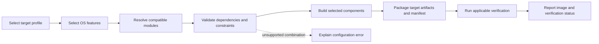

# Product direction and agreed scope

## Agreed goal

Build an OS assembler that selects compatible RustOS modules for a chosen hardware target and produces its bootable OS image. The initial assembler builds our own RustOS components. Assembly of Linux distributions and third-party kernels is outside the initial scope.

This direction was agreed in the project discussion on 2026-10-31. It establishes product scope; it does not approve unresolved technical designs or establish implementation completion.

## Target sequence

1. Emulator target for repeatable development and automated tests. Emulator and machine selection remain open.
2. Raspberry Pi Zero 2 W as the first physical target.
3. Raspberry Pi 5 as the second physical target, validating reuse of portable services with separate board configuration and required drivers.

The user has Zero 2 W and Pi 5 hardware available. RAM capacity, board revisions, serial adapters, boot media, and test setup remain to be recorded before hardware verification.

The M1 environment direction is now agreed and probed: native Windows, QEMU virt/Cortex-A53, and the AArch64 soft-float Rust target. See [environment verification](m1-environment-verification.md). TOML with separate user configuration, target profiles, and module catalog is agreed; initial profiles and modules stay repository-local with explicit versions. See the [detailed schema proposal](configuration-design.md), which still needs review.

## Assembly model

Use build-time selection of architecture support, board support, compatible drivers, kernel services, and OS features. Validate required dependencies and reject unsupported combinations before producing an image. Runtime module loading is deferred.

Target profiles determine supported modules, boot assets, and packaging. Produce hardware-appropriate images; an SD-card image is the intended Raspberry Pi deliverable. ISO packaging is deferred until a target requiring it is supported. Precise image layouts remain design work.

Required assembly outputs are the boot artifact or image appropriate to the milestone, a resolved component/version manifest, build diagnostics, and references to verification results. Build success, emulator verification, and hardware verification are separate outcomes.

## Revised early milestone scope

| Milestone | Required outcome | Evidence |
| --- | --- | --- |
| M1: Minimal assembler and emulator boot | A minimal target profile selects RustOS components; unsupported configurations are rejected; a reproducible build produces an emulator-loadable kernel and manifest; serial startup and deliberate panic diagnostics run in the selected emulator | Configuration validation results, build instructions and recorded versions, artifact inspection, automated emulator output checks with timeout and pass/fail results |
| M2: First hardware image | A Zero 2 W profile reuses portable components and packages required board boot assets into a documented bootable SD-card image | Image manifest, documented media preparation and serial setup, hardware startup and panic output |
| Later portability gate | A separate Pi 5 profile produces a verified board image | Recorded reused components, board-specific changes, and Pi 5 boot evidence |

M1 does not require an SD-card image or establish Raspberry Pi compatibility. Hardware image production is verified in M2. Shell, storage services, multitasking, and language runtimes are later feature increments. M1 is complete on 2026-11-01 within its [recorded acceptance scope](m1-acceptance.md); M2 and Pi 5 work remain open. The discussion statuses below preserve the original planning history; the dashboard holds current states.

## Gap discussion status

1. Product direction and initial target order agreed. Emulator selection and detailed milestone acceptance procedures remain open.
2. Testable requirements: configuration-file and command-line interface agreed; graphical interface deferred. [Assembler requirement proposals](assembler-requirements.md) define inputs, validation, outputs, and acceptance scenarios. Detailed requirements and technical choices still require review.
3. Component ownership: agreed. One assembler application contains CLI/configuration, target profiles, catalog/resolver, build orchestrator, packager, and verification runner. See [component ownership and interface responsibilities](assembler-architecture.md). Concrete types and schemas remain pending.
4. Workflows and failure handling: policy agreed, including the [twice-reviewed verification/publication rules](verification-publication-review.md). See [workflow and failure policy](assembler-workflows.md); concrete process-control and publication design remain pending.
5. Requirement-level traceability and evidence: visibility requested and dashboard extension underway. Planning decisions, open gaps, requirement stages, workflow policies, and recorded runs must remain distinct. No run completion is implied by a policy agreement.
6. Priorities and active-work limits: agreed. One selected delivery milestone, at most two active work items (one primary and one supporting research), and an ordered M1 queue. See [priorities and status reconciliation](priorities.md).

The [plan reevaluation](plan-evaluation.md) assesses all six gaps after these discussions. Current feature proposals are drafts; concrete platform and interface choices remain open.
